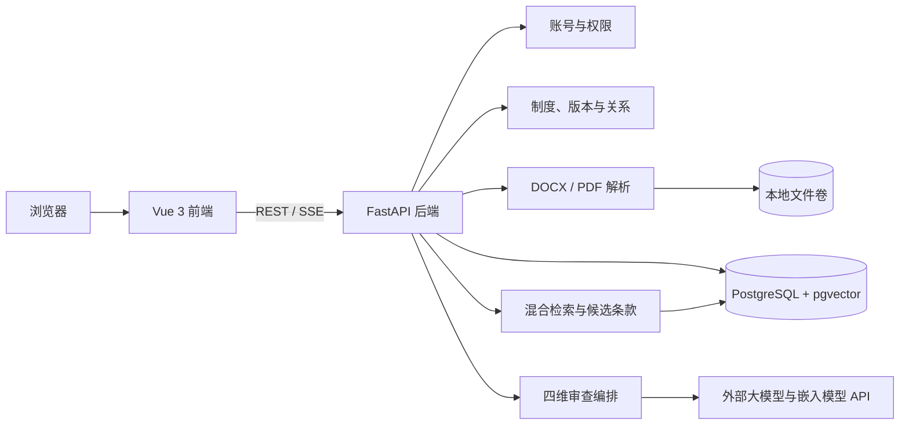

# 制度智能审查系统 M1 技术方案

## 1. 文档信息

| 项目 | 内容 |
|---|---|
| 文档版本 | 1.0.0 |
| 生成日期 | 2026-07-30 |
| 对应里程碑 | M1：技术方案确认 |
| 需求基线 | `AI_REQUIREMENTS.md` 0.1.0、`AI_IMPLEMENTATION_TASKS.md` 0.1.1 |
| 当前状态 | 已确认 |
| 确认日期 | 2026-07-30 |
| 确认记录 | 用户明确回复“已确认” |

本文档是 `BLOCK-001` 至 `BLOCK-004` 的正式技术基线。后续开发应遵循本文方案；如需更换核心技术，应先更新本文并记录新的确认决定。

## 2. 设计目标

技术方案优先满足以下目标：

1. 支撑论文和答辩使用的完整、可运行演示原型。
2. 覆盖制度管理、关系维护、文件解析、候选条款召回、四维审查、报告处理和管理员功能。
3. 适配约 1000 份制度、17 个业务部门的当前项目单位规模。
4. 保持证据、原文位置、模型判断和人工处理记录可追溯。
5. 减少第一版需要部署和维护的独立服务数量。
6. 保留更换大模型、嵌入模型、中文分词器和检索算法的能力。

## 3. 候选方案比较

| 方案 | 主要组成 | 优点 | 主要问题 | 结论 |
|---|---|---|---|---|
| A：一体化原型方案 | Vue 3、FastAPI、PostgreSQL、pgvector、Docker Compose | 前后端清晰；AI 与文档处理生态完整；关系数据、全文索引和向量集中管理；服务数量少 | 中文关键词检索质量需要用真实制度验证 | 推荐 |
| B：独立搜索服务方案 | Vue/React、FastAPI、PostgreSQL、OpenSearch/Elasticsearch、独立向量库 | 搜索、分析和扩展能力更强 | 部署复杂、数据同步链路长；对当前约 1000 份制度规模偏重 | 第一版不采用 |
| C：极简演示方案 | Vue、FastAPI、SQLite、FAISS | 开始开发快、依赖少 | 并发、迁移、关系数据、备份和多用户扩展较弱；后续重构成本高 | 不采用 |

推荐方案 A。它把结构化业务数据、关键词索引和向量索引放在同一个数据库中，适合本项目规模，也便于论文说明系统的数据流和检索过程。

## 4. 推荐总体架构



系统采用前后端分离的单体应用。第一版不拆分微服务，不引入 Redis、消息队列、独立搜索引擎或独立向量数据库。

## 5. 前端方案

### 5.1 推荐选型

| 类别 | 推荐技术 | 用途 |
|---|---|---|
| 语言 | TypeScript | 页面、组件和接口类型 |
| 框架 | Vue 3 | 前端应用 |
| 构建工具 | Vite | 本地开发和生产构建 |
| 组件库 | Element Plus | 表单、表格、筛选、弹窗、标签页和反馈组件 |
| 路由 | Vue Router | 登录区、审查人员区和管理员区路由 |
| 状态管理 | Pinia | 当前用户、权限和跨页面临时数据 |
| 接口访问 | 原生 `fetch` 封装 | REST 请求和统一错误处理 |

### 5.2 选择理由

- 本系统以后台管理页面、表单、筛选、表格和详情为主，Vue 3 与 Element Plus 能快速形成统一界面。
- TypeScript 用于约束四维报告的不同字段结构，避免把四类问题错误地渲染成统一模板。
- Vue Router 用于隔离管理员与审查人员功能区域。
- Pinia 只保存前端会话和跨页面临时选择，不把审查运行状态做成持久化任务状态。

### 5.3 前端实现约束

1. 按 `PERM-001` 至 `PERM-003` 控制按钮和入口，后端仍需再次鉴权。
2. 四维报告使用四种明确的数据类型和展示组件。
3. 只有制度冲突维度显示对比制度原文。
4. 前端只显示当次审查的“正在执行、成功、失败”，不提供任务状态字段或筛选器。
5. 页面不得出现风险等级和模型置信度。

## 6. 后端与接口方案

### 6.1 推荐选型

| 类别 | 推荐技术 | 用途 |
|---|---|---|
| 语言 | Python 3.12 | 业务、解析、检索和模型调用 |
| Web 框架 | FastAPI | REST API、参数校验、鉴权和接口文档 |
| 数据模型 | Pydantic | 请求、响应和模型结构化输出校验 |
| ORM | SQLAlchemy 2 | 关系数据访问 |
| 数据库迁移 | Alembic | 数据表版本管理 |
| 测试 | pytest | 单元测试和接口测试 |

### 6.2 接口约定

1. 业务接口使用版本化 REST JSON，例如 `/api/v1/...`。
2. 上传制度和临时待审文件使用 `multipart/form-data`。
3. 普通错误使用统一 JSON 错误结构，至少包含错误代码、可读说明和字段错误。
4. 当次审查反馈使用 SSE 流式返回阶段信息和最终结果。
5. 系统只保存最终形成的审查记录、问题、证据和人工处理记录，不保存独立任务状态。
6. FastAPI 自动生成的 OpenAPI 文档作为前后端联调依据。

### 6.3 认证建议

系统使用自有用户名和密码。推荐由后端签发会话凭据并放入 `HttpOnly` Cookie，密码只保存安全哈希。密码复杂度、会话有效期、失败锁定等参数仍属于未确定的非功能要求，不在 M1 中固化。

## 7. 数据与文件存储方案

### 7.1 数据库

采用 PostgreSQL 18，并安装 pgvector 扩展。所有 `DATA-001` 至 `DATA-015` 的结构化数据进入 PostgreSQL。

主要数据类别：

- 用户、角色与三项可配置权限。
- 部门、分类、一级与二级单位隶属。
- 制度、版本、关系、条款和解析状态。
- 审查记录、四维问题、证据和人工处理记录。
- 临时待审文件元数据。
- 制度新增、删除和恢复操作历史。

制度删除采用业务删除字段；管理员执行历史清理时，再按已确认规则永久删除关联数据。

### 7.2 原始文件

原始 `.docx`、PDF 和临时待审文件存放在应用文件卷中，数据库只保存受控相对路径、文件哈希、MIME 类型、大小和版本归属。

第一版不引入 MinIO 或云对象存储。代码仓库只提供目录结构和 `.env.example`，真实制度文件、上传目录、密钥和环境变量不得提交到 Git。

### 7.3 向量

条款向量保存到 pgvector 列中，并记录：

- 嵌入模型标识。
- 向量维度。
- 内容哈希。
- 生成时间。

更换嵌入模型时，通过内容哈希和模型标识触发重新生成，不覆盖不同模型产生的向量。

## 8. 文件解析方案

| 文件类型 | 解析工具 | 第一版边界 |
|---|---|---|
| `.docx` | python-docx | 读取段落和标题；不解析表格 |
| 普通文字 PDF | PyMuPDF | 提取文本；不处理扫描件和 OCR |

解析流程：

1. 校验扩展名、MIME 类型和文件可读取性。
2. 计算文件哈希并保存原文件。
3. 按原始顺序提取段落。
4. 识别章、节、条和普通段落，形成可展示的层级与顺序号。
5. 保存条款文本、标题路径、段落序号和字符范围。
6. 生成关键词索引和向量。

原文位置使用“标题路径 + 条款编号 + 段落序号”，不依赖页码。最终切分规则必须等待真实制度文件和 `OPEN-001`，因此解析器应采用可替换的规则模块。

## 9. 候选条款检索方案

采用“关系范围过滤 + 关键词检索 + 向量检索 + 融合排序”的混合检索。

### 9.1 检索流程

1. 根据待审制度及其上位、下位、关联、引用和被引用关系确定可检索制度集合。
2. 排除业务删除的制度；制度生效状态的参与规则待后续业务确认。
3. 对待审条款进行中文分词，执行 PostgreSQL 全文检索。
4. 使用 pgvector 执行语义相似度检索。
5. 使用倒数排名融合（RRF）合并两组结果。
6. 返回候选条款、来源制度、条款位置和召回依据。
7. 用户选择候选条款后，只有被选择内容进入制度冲突审查。

### 9.2 中文检索

第一版推荐在 Python 层使用 jieba 生成检索词，再写入 PostgreSQL 的 `tsvector` 并建立 GIN 索引。分词器封装为独立接口，以便真实制度验证后替换。

该方案的已知风险是：制度名称、组织名称和专业术语可能被错误切分。进入 M4 前应使用真实制度建立自定义词典并验证召回结果。

## 10. 大模型调用方案

### 10.1 供应商中立适配层

后端定义两类独立接口：

- `ChatModelProvider`：四维问题判断、判断说明、后果和修改建议。
- `EmbeddingProvider`：条款向量生成。

调用配置通过环境变量提供：

- API Base URL。
- API Key。
- Chat Model。
- Embedding Model。
- 超时和重试参数。

第一版采用国内大模型厂商普遍支持的 Chat Completions 请求结构，但不在业务逻辑中写死供应商。M5 默认配置智谱 GLM-4.7，后续可切换 DeepSeek 等国内供应商而不影响审查业务层。

### 10.2 审查编排

1. 规则匹配维度先执行确定性规则，再由模型生成结构化说明和建议。
2. 制度冲突维度只传入用户选中的候选条款。
3. 语义分歧和一致性维度只传入完成判断所需的条款上下文。
4. 输出必须通过 Pydantic 模型校验，不合格时进行有限重试。
5. 每个问题保存输入条款、证据条款、证据位置、判断说明、可能后果、修改建议和证据状态。
6. 证据不足时仍保存问题，并显示“证据不足、请人工判断”。
7. 第一版不引入 LangChain 等编排框架，避免隐藏证据拼装和结构化输出过程。

规则匹配的完整规则仍受 `BLOCK-006` 约束；M1 只确定模型和规则调用边界，不提前固化规则内容。

## 11. 本地开发与部署方案

推荐 Docker Compose 统一启动：

| 服务 | 内容 |
|---|---|
| `frontend` | Vue 生产构建，由 Nginx 提供静态资源并转发 API |
| `api` | FastAPI 应用 |
| `db` | PostgreSQL 18 与 pgvector |
| `db-data` | 数据库持久化卷 |
| `file-data` | 制度原文件和临时文件持久化卷 |

本地开发时可分别启动前端和后端热更新服务，数据库继续使用容器。第一版不包含公网生产部署、自动备份、监控和高可用方案，这些内容在非功能目标确认后补充。

## 12. 建议仓库结构

```text
.
├── frontend/
│   ├── src/
│   └── tests/
├── backend/
│   ├── app/
│   │   ├── api/
│   │   ├── core/
│   │   ├── models/
│   │   ├── schemas/
│   │   ├── services/
│   │   ├── parsers/
│   │   ├── retrieval/
│   │   └── ai/
│   ├── migrations/
│   └── tests/
├── docs/
├── compose.yaml
└── .env.example
```

## 13. 阻塞项处理结果

| 阻塞项 | 推荐结论 | 确认后状态 |
|---|---|---|
| BLOCK-001 | Vue 3 + TypeScript + Vite + Element Plus + Vue Router + Pinia | 已解除 |
| BLOCK-002 | Python 3.12 + FastAPI + Pydantic + SQLAlchemy 2 + Alembic；REST JSON + SSE | 已解除 |
| BLOCK-003 | PostgreSQL 18 + pgvector；原文件使用本地持久化卷；PostgreSQL 全文检索与向量混合召回 | 已解除 |
| BLOCK-004 | 国内大模型兼容适配层；Chat Completions 调用结构；具体 API 地址和模型由环境配置 | 已解除；M5 使用智谱 GLM-4.7 |

`BLOCK-005` 至 `BLOCK-008` 不属于 M1，继续保持未解决状态。

## 14. M1 确认记录

用户已于 2026-07-30 确认以下六项：

1. 已确认：前端采用 Vue 3 技术组合。
2. 已确认：后端采用 Python 与 FastAPI 技术组合。
3. 已确认：PostgreSQL 与 pgvector 同时承担业务数据、全文索引和向量存储。
4. 已确认：原始制度文件存放在本地持久化文件卷。
5. 已确认：只使用国内大模型供应商；采用 Chat Completions 兼容适配层，M5 默认使用智谱 GLM-4.7，具体地址和模型通过环境变量配置。
6. 已确认：使用 Docker Compose 完成本地开发环境和第一版部署。

确认结果：M1 完成，`BLOCK-001` 至 `BLOCK-004` 已解决，M2 正式解除技术阻塞。

## 15. 官方资料依据

- [Vue：TypeScript with Composition API](https://vuejs.org/guide/typescript/overview)
- [Vite：Getting Started](https://vite.dev/guide/)
- [Element Plus：Installation](https://element-plus.org/en-US/guide/installation.html)
- [Vue Router](https://router.vuejs.org/)
- [Pinia](https://pinia.vuejs.org/introduction.html)
- [FastAPI Features](https://fastapi.tiangolo.com/features/)
- [SQLAlchemy 2.0 ORM](https://docs.sqlalchemy.org/en/20/orm/)
- [Alembic Documentation](https://alembic.sqlalchemy.org/en/latest/)
- [Pydantic Models](https://docs.pydantic.dev/latest/concepts/models/)
- [PostgreSQL 18：Text Search Types](https://www.postgresql.org/docs/18/datatype-textsearch.html)
- [PostgreSQL 18：Text Search Functions and Operators](https://www.postgresql.org/docs/18/functions-textsearch.html)
- [PostgreSQL 18：Tables and Indexes](https://www.postgresql.org/docs/18/textsearch-tables.html)
- [pgvector](https://github.com/pgvector/pgvector)
- [jieba](https://github.com/fxsjy/jieba)
- [python-docx Quickstart](https://python-docx.readthedocs.io/en/latest/user/quickstart.html)
- [PyMuPDF：The Basics](https://pymupdf.readthedocs.io/en/latest/the-basics.html)
- [Docker Compose application model](https://docs.docker.com/compose/intro/compose-application-model/)
